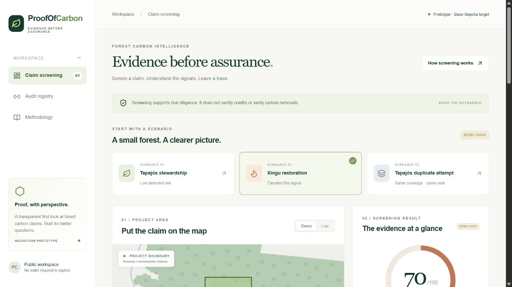
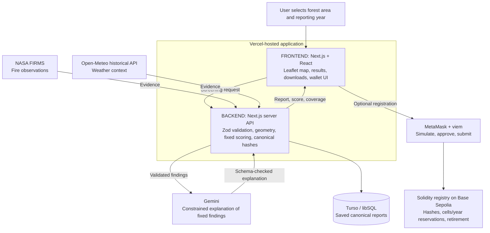

# ProofOfCarbon

### Evidence before assurance

**A working forest carbon claim screening prototype that makes environmental evidence inspectable and records geographic reservations on a blockchain.**

[Open the live app](https://proof-of-carbon-five.vercel.app) · [View the deployed registry](https://sepolia.basescan.org/address/0x19d794c34698d240c56dbf6d61c5508794024af8) · [Technical reference](docs/TECHNICAL.md)

> Screening supports due diligence. It does not certify carbon credits, verify carbon removals, or establish additionality or permanence. Claimed tonnes are user supplied and unverified.



## The idea in 30 seconds

Imagine two accounts submitting claims for the same forest area and reporting year. A reviewer needs to inspect the environmental evidence, understand how a screening result was calculated, and identify conflicting registrations.

ProofOfCarbon brings those steps together:

1. **Select** a forest boundary and reporting year.
2. **Screen** fire observations and weather context using reproducible rules.
3. **Understand** the result through evidence coverage and a constrained Gemini explanation.
4. **Download** a saved report with reproducible cryptographic fingerprints.
5. **Register** its hashes and geographic cells through MetaMask on Base Sepolia.

A second registration that includes an already reserved cell for the same year fails. Retiring the original record preserves its reservations.

## For judges: a two-minute tour

**No login, wallet, or API key is needed to explore the hosted screening demo.**

| Step | Where to click | What it demonstrates |
| --- | --- | --- |
| 1 | **Claim screening → Tapajós stewardship**, then **Screen this claim** below the map | A labeled synthetic example with zero hotspots and zero fire risk points |
| 2 | Select **Xingu restoration** and screen again | Five synthetic hotspots produce 70 fire risk points |
| 3 | Switch to **Live** and screen a supported completed year | Real adapters expose evidence coverage and limitations. Partial annual fire coverage produces **review required** |
| 4 | Download the claim/report JSON | Inspectable report content and reproducible hashes |
| 5 | Open **Audit registry** | Wallet connection, registration, transaction links, and owner retirement |

**Important for repeat demos:** Tapajós and Xingu 2025 cells were used during the hosted walkthrough. Their registrations can already be reserved, including after retirement. A duplicate rejection is expected. The “Tapajós duplicate attempt” scenario deliberately overlaps Tapajós. Use existing transaction links to show completed writes. Do not expect another wallet to bypass the reservations.

The activity list belongs to the browser that submitted the transactions. A new browser can show an empty list even though records remain on-chain. Use the [contract explorer](https://sepolia.basescan.org/address/0x19d794c34698d240c56dbf6d61c5508794024af8) to inspect the deployed address independently.

## Architecture

The website and backend share one Next.js application. The blockchain write is a separate action approved by the user in MetaMask.



**Server secrets stay on the backend.** MetaMask controls transaction approval. A wallet is optional for screening and required for blockchain writes.

| Layer | Technology | Role |
| --- | --- | --- |
| Interface | Next.js App Router, React, TypeScript, Tailwind/CSS | Claim inputs, results, audit interface |
| Map | Leaflet | Polygon selection and display |
| Backend | Next.js route handlers, Zod | Input validation and screening pipeline |
| Evidence | NASA FIRMS, Open-Meteo ERA5 | Fire observations and historical precipitation context |
| Explanation | Gemini Interactions API | Explain deterministic findings with schema validation |
| Persistence | Turso through libSQL | Durable hosted report storage |
| Wallet | MetaMask, viem | Chain checks, simulation, submission, receipt confirmation |
| Contract | Solidity, Base Sepolia | Submitted cell conflicts and owner retirement |
| Verification | Vitest, Ganache, solc, Foundry | Application, wallet, geometry, and contract checks |

## What the score means

**The score measures detected risk points.** It is not a probability, a carbon quality rating, or a percentage verified. The weights are heuristic prototype choices.

| Input | Fire risk contribution |
| --- | ---: |
| 0 hotspots with full annual input | 0 |
| 1–2 hotspots with full annual input | 40 |
| 3+ hotspots with full annual input | 70 |
| Historical weather | 0, context only |

With sufficient required evidence, scores below 30 mean **low detected risk**, 30–59 mean **review required**, and 60+ mean **high detected risk**. Missing or partial required annual fire evidence overrides the outcome to **review required**.

Evidence completeness is separate: 75% for required annual fire coverage and 25% for complete annual weather context. Completeness describes input availability, not confidence that a claim is true.

### Live evidence versus synthetic scenarios

- **Live fire:** the current NASA FIRMS adapter requests the final **five days** of a supported completed reporting year, parses dates/coordinates, and filters detections to the polygon. This sample cannot satisfy the annual fire rule. Live annual outcomes therefore require review.
- **Live weather:** Open-Meteo historical ERA5 provides daily precipitation at the bounding-box center. The adapter checks expected dates and valid values. A single reanalysis point is context, not a field survey.
- **Demo fixtures:** invented observations illustrate quiet, fire, and duplicate cases. Geographic positions are real, but the project names and claims are fictional examples. Synthetic coverage never represents real annual verification.
- **Failures:** unavailable evidence stays visible. Live mode does not silently substitute demo fixtures.

### Why AI cannot change the score

The rules run before Gemini. The explanation service constrains model output to statements derived from the supplied findings and validates the response with Zod, including evidence references. Invalid responses or provider failures produce a labeled template fallback. The app shows the explanation origin. User notes are excluded from the AI prompt.

## What the blockchain adds

**Network:** Base Sepolia, chain ID `84532`
**Registry:** [`0x19d794c34698d240c56dbf6d61c5508794024af8`](https://sepolia.basescan.org/address/0x19d794c34698d240c56dbf6d61c5508794024af8)

The contract stores owner, claim/report hashes, submitted score, reporting year, timestamp, retirement status, and submitted cells. Registration reserves cells atomically by year. Only the owner can retire a record, and retirement never releases reservations.

The hosted two-account walkthrough demonstrated registration through MetaMask, rejection of an overlapping registration from another account, owner-only retirement controls, and confirmed retirement. Local contract tests also cover permanent reservations after retirement.

**Trust boundary:** the contract accepts caller-supplied cells, scores, and hashes. It cannot independently verify the polygon or recompute the off-chain screening. Callers can omit cells or reserve arbitrary ones. Enforcement applies to submitted cells within this registry, not every carbon registry worldwide. The conservative 0.01° grid can also conflict for nearby non-overlapping polygons.

There is no token issuance, carbon credit trading, or recognized credit retirement. Hashes check content integrity, not truth or guaranteed availability.

## Reports that can be checked

Canonicalization converts geometry and quantities to defined integer representations, normalizes polygon winding/start position, and sorts JSON object keys. Ethereum Keccak-256 hashes commit to the canonical claim and report payloads.

Downloading the canonical JSON lets a reviewer recompute its fingerprint and compare it with the recorded hash. Report timestamps mean separate screening runs can legitimately have different report hashes.

Reports are publicly retrievable by hash. **Do not include confidential information in claim notes.** Detailed formats, geometry limits, and hashing rules are in the [technical reference](docs/TECHNICAL.md).

## Run locally

Use Node.js **22.12+** and npm. The project has been tested with Node 24. Synthetic screening works without external API credentials or a wallet.

```bash
npm ci
```

Copy `.env.example` to `.env.local`:

```powershell
# Windows PowerShell
Copy-Item .env.example .env.local
```

```bash
# macOS / Linux
cp .env.example .env.local
```

```bash
npm run dev
```

Open [localhost:3000](http://127.0.0.1:3000), select a demo scenario, and screen it. Without a Gemini key, the app uses its labeled explanation fallback.

### Configuration

| Variable | Used for |
| --- | --- |
| `GEMINI_API_KEY` | Optional server-side AI explanations |
| `GEMINI_MODEL` | Configured explanation model, see `.env.example` |
| `FIRMS_MAP_KEY` | Server-side live NASA FIRMS access |
| `DATABASE_URL` | Development SQLite or production durable Turso/libSQL URL |
| `DATABASE_AUTH_TOKEN` | Server-side database authentication |
| `NEXT_PUBLIC_CHAIN_ID` | Public chain ID, `84532` for Base Sepolia |
| `NEXT_PUBLIC_RPC_URL` | Public RPC endpoint |
| `NEXT_PUBLIC_REGISTRY_ADDRESS` | Deployed registry address |

Production refuses local filesystem database URLs. Keep `.env.local` ignored. Never commit credentials or share a wallet recovery phrase/private key. Existing-contract wallet use does not require a deployer private key.

For a fresh disposable local blockchain:

```bash
npm run deploy:local
```

Copy its printed public chain configuration into `.env.local`, restart the app, and use the local demo wallet. This is a local Ganache chain, not Base Sepolia. See [deployment instructions](docs/DEPLOYMENT.md).

## Verification

```bash
npm run lint
npm run typecheck
npm test
npm run chain:test
npm run build
# With Foundry/compiler available:
npm run test:foundry -- --offline
# With the development server running:
npm run smoke -- --live
```

Application tests cover canonicalization, geometry, screening, and wallet connection sequencing. Contract tests execute real bytecode on a local EVM and cover duplicate reservations, different years, retirement authorization, bounds, and atomic rollback. Wallet regression tests include account changes during network switching.

External live checks depend on provider availability and credentials. Local EVM checks and hosted MetaMask checks are distinct verification paths.

## Limits and next steps

This is a deployed hackathon prototype, not a production certification service.

- Validate complete annual fire coverage before enabling annual live risk classification.
- Calibrate rules and add independent validation of submitted scores and geographic cells.
- Add production access controls, distributed rate limiting, monitoring, backups, and retention policies.
- Replace the browser-local activity index with a complete event index if an exhaustive explorer is required.
- Evaluate finer geographic handling and integration with external registries.

## Explore the code

| Location | Responsibility |
| --- | --- |
| `app/` | Pages and server API routes |
| `components/` | Map and wallet/registry interface |
| `lib/pipeline.ts` | Screening orchestration |
| `lib/live.ts`, `lib/fixtures.ts` | Real evidence and explicit synthetic fixtures |
| `lib/scoring.ts`, `lib/explain.ts` | Fixed rules and constrained explanations |
| `lib/canonical.ts`, `lib/geo.ts` | Integrity and geographic cells |
| `lib/storage.ts` | Report persistence |
| `contracts/src/ProofOfCarbon.sol` | Registry contract |
| `tests/`, `scripts/`, `contracts/test/` | Verification and deployment tools |

Further reading: [Technical reference](docs/TECHNICAL.md) · [Deployment](docs/DEPLOYMENT.md) · [Demo guide](docs/DEMO.md) · [Verification handoff](docs/HANDOFF.md)
