# ProofOfCarbon

A forest carbon **claim-screening** hackathon prototype. It collects environmental context, runs reproducible rules, explains the result, and anchors report integrity in a small EVM registry. It does not certify carbon credits, calculate verified removals, or establish additionality or permanence. Claimed tonnes are user-provided and unverified.

## Run locally

Requirements: Node 22.12+ (tested with Node 24), npm; Foundry for `forge test`. No API key or wallet is needed for seeded screening.

```powershell
npm ci
Copy-Item .env.example .env.local
npm run dev
```

Open http://127.0.0.1:3000. Choose a seeded scenario and **Screen this claim**. Demo evidence is conspicuously labeled. Live mode lets you click vertices on the Leaflet map and finish a polygon, or edit JSON coordinates using the keyboard. A server-side pipeline validates geometry before requests. Demo mode always pins geometry and reporting year to the chosen seed, even if a client sends altered coordinates.

### Local blockchain demo

In a second terminal:

```powershell
npm run deploy:local
```

This starts a loopback-only Ganache EVM at port 8545, chain 31337, and deploys the same Solidity contract. Copy the printed public configuration into `.env.local`:

```dotenv
NEXT_PUBLIC_CHAIN_ID=31337
NEXT_PUBLIC_RPC_URL=http://127.0.0.1:8545
NEXT_PUBLIC_REGISTRY_ADDRESS=<actual printed address>
```

Restart Next.js. Use **Use local demo wallet** to submit genuine local EVM transactions using loopback unlocked accounts; no private keys are displayed. The local chain resets on process restart. These transactions are never described as Base Sepolia transactions and have no fabricated explorer links.

1. Screen Tapajós, connect the local wallet, register the report. Wait for confirmation.
2. Screen Xingu, register its separate cells.
3. Select the duplicate scenario, screen it, register: simulation invokes the real contract and returns `CellReserved`. The intentionally failing transaction is not broadcast and is not shown as a confirmed write.
4. Retire a record as its owner. The contract preserves reservations. Retry the duplicate and it still fails.

Browser wallet writes use viem, chain checks, `simulateContract`, wallet submission, then confirmed receipts. Account/network changes require reconnection. User rejection, wrong network, RPC failure, no contract, contract rejection, and pending states are visible. Report browsing never requires a wallet.

## Architecture

Next.js App Router + TypeScript + Tailwind v4/CSS, Leaflet, viem, Zod, libSQL, Solidity/Foundry. No separate orchestration service. See [Mermaid source](docs/architecture.mmd).

```mermaid
flowchart LR
  UI[Dashboard + polygon] --> P[Validate + canonicalize]
  P --> A[Live adapters or explicit demo fixtures]
  A --> S[Deterministic screening]
  S --> G[Schema-constrained Gemini or labeled template]
  G --> D[(Persist canonical report in libSQL)]
  D --> J[Download JSON + hashes]
  J --> W[Wallet simulation + transaction]
  W --> R[Base Sepolia registry]
  R --> H[Confirmed audit / permanent cell reservation]
```



## Scoring v1

Score means **detected risk points**, not probability, confidence, carbon quality, or percent verified. Higher is more detected risk. These weights are heuristic demonstration choices, not calibrated science.

| Rule            | Required input                    | Contribution                      |
| --------------- | --------------------------------- | --------------------------------- |
| FIRE-01         | Available full-year hotspot input | 0 hotspots: +0; 1–2: +40; 3+: +70 |
| WEATHER-CONTEXT | Full-year daily precipitation     | +0; context only                  |

Thresholds: score <30 → **low detected risk**; 30–59 → **review required**; ≥60 → **high detected risk**. Missing/partial required annual fire evidence **always forces review required**, regardless of available observations. No signal labels a claim fraudulent. No risk calculation derives tonnes from fire or weather.

Completeness is separate: 75% for required annual fire coverage and 25% for complete annual weather context. This is input availability, not confidence that the project is real or that the claim is true. Full fixture coverage is only full _synthetic input_ coverage. No zero score establishes safety.

## Evidence and AI boundaries

All adapters share `EvidenceAdapter.collect(claim)`. Evidence records source URL, period, fetch time, spatial coverage, availability, integer-scaled values, errors, limitations, and demo flag.

- **Open-Meteo:** working keyless historical ERA5 adapter for completed years, full-year daily precipitation at the polygon bounding-box center. Requires every expected day and non-null nonnegative values. Single reanalysis grid point is not a polygon survey. Current/incomplete years fail explicitly. No drought rule exists without a baseline.
- **NASA FIRMS:** server-only MAP key. VIIRS SNPP standard-processing query for the final 5 days of a completed reporting year (2012 onward, with processing lag). Parses coordinates and acquisition dates and filters detections against the submitted polygon. Availability/access errors remain visible. This bounded sample **cannot satisfy the annual rule**, which stays disabled in live mode. Standard-product coverage must be checked against FIRMS availability for the requested period; no present-day substitution occurs. Annual chunking or a validated annual dataset is future work.
- **Fixtures:** all observations are invented, not NASA/Open-Meteo responses. Coordinates are real geographic positions chosen as fictional project examples; project names/claims do not describe actual credited projects. 2025 fixture precipitation and counts are synthetic. Quiet and duplicate share cells; Xingu has five invented hotspots. No fabricated transactions exist.
- **Gemini:** server-side Interactions API (`store: false`) with JSON Schema and local Zod validation. The model selects/orders explanation statements from exact enums built from supplied deterministic findings. This deliberately restrictive design prevents new factual prose or score mutation. Each finding's evidence IDs must match its source rule; unsupported facts or references trigger a template fallback. Supporting user text is retained for human review and hashing but excluded from the AI prompt. Source text is data, not instructions. The origin and fallback reason are shown. This is a constrained AI explanation prototype, not an autonomous verifier.

## Canonical integrity v1

`claim-v1` uses Unicode NFC project/notes, integer kg CO₂e (up to three decimal tonnes), integer microdegree coordinates, no duplicated closing vertex, counterclockwise winding, and a lexicographically smallest first vertex. Geometry is validated after quantization. A single simple ring only: no holes, touching/self-intersecting edges, repeated/collinear vertices, antimeridian crossing, or latitude outside ±80°. Same geometry with reversed winding, closure or rotated start produces the same hash for otherwise identical metadata.

Canonical JSON sorts object keys lexicographically, preserves array order, uses JSON string escaping, and accepts safe integers only (negative zero becomes zero). Hash is Ethereum Keccak-256 of UTF-8 canonical bytes. Claim hash commits to metadata, notes, normalized geometry, grid version, and sorted cells.

The report hash commits to `reportPayload(report)`: version, creation time, mode, scenario, full canonical claim, claim hash, normalized evidence, screening, and explanation. `id`, `reportHash`, and operational `storage` label are excluded from their own hash. Downloaded report JSON is exactly this payload, so its byte hash can be checked directly; claim JSON is similarly canonical. Creation/fetch timestamps intentionally make repeated screening reports distinct. Reports are publicly retrievable by their hash; do not put confidential information in notes.

## Geographic cells and contract trust

Grid `degree-0.01-v1`: 0.01° by 0.01° cells, roughly 1.11 km north–south and 1.11·cos(latitude) km east–west. Integer shifted microdegree grid indices map to `cellId = y * 36000 + x + 1`. Cell range 1..648000000. All cells touched by a closed polygon are included: interior vertices, cell corners inside the polygon, edge intersections, and collinear/corner boundaries. Grid-aligned edges reserve cells on **both sides**. Sorted unique IDs; maximum 64 cells. Input bounds: 64 vertices, maximum 0.15° extent in either axis, 100 m²–25 km² approximate local planar area. Area is a prototype bound, not geodetic carbon accounting. Cells/gas are bounded independently. Near-limit areas should be reduced, not interpreted as precise surveying.

The registry stores owner, claim/report hashes, uint8 score ≤100, year 2000..2100, timestamp, retired flag, per-record cells and permanent year/cell reservations. Events expose registrations/retirements. Any reserved cell for the same year rejects the entire registration atomically. Different years are independent. Only the owner can retire; repeat retirement fails; retirement never releases cells.

**Critical trust boundary:** anyone can call the contract with their own score, hashes and cells. The contract cannot verify that submitted cells match an off-chain polygon or that the app computed the score. A caller can omit cells or reserve arbitrary ones. This is submitted-cell conflict enforcement, not global duplicate prevention, proof of geometric overlap, certification, or an oracle. Nearby non-overlapping polygons may conflict due to coarse cells. No external registry synchronization, tokens, credit issuance or trading. Hashes provide integrity **only**; they do not prove report contents true or guarantee availability.

## Persistence

Development defaults to SQLite (`work/proof-of-carbon.db`) through libSQL. Reports use immutable insert-by-hash records. In production the adapter **refuses local file URLs** and requires a durable libSQL/Turso database URL (`libsql://…` or `https://…`) and optional server-side token. Provision a database and set environment secrets on your host. Do not deploy ephemeral filesystem persistence. Backups, retention, abuse protection and operational monitoring are needed before public production usage. The public unauthenticated endpoint has input bounds and fetch timeouts but no distributed rate limiter; use a protected hackathon deployment.

The audit list is a browser-local index of confirmed transactions, partitioned by chain/address. Refresh reads retirement from the contract. It is not an exhaustive registry explorer and does not replace on-chain events; losing browser state does not remove blockchain records. Server reports and browser activity have different persistence roles.

## Tests and checks

```powershell
npm run lint
npm run typecheck
npm test
npm run chain:test
npm run build
npm run test:foundry -- --offline
# With the development server running:
npm run smoke -- --live
forge test --root contracts -vv
```

`chain:test` compiles with solc 0.8.30 and executes the real contract on an ephemeral local EVM, including duplicate conflicts, different-year registration, authorization, repeated retirement, score/cell limits and atomic rollback. Foundry tests have no external forge-std dependency. Build does not require production storage credentials; executing a production screening does.

## Deployment

See [deployment instructions](docs/DEPLOYMENT.md). No credentials were supplied with the brief. Never paste a private key in chat or commit `.env.local`. The scripts print only public addresses/transaction hashes. Base Sepolia target is chain 84532. Deploy only with an authorized environment signer and test ETH. The app is not deployed merely because scripts exist.

## Integration references checked during implementation

- [Next.js route handlers](https://nextjs.org/docs/app/getting-started/route-handlers)
- [Leaflet 1.9.4 reference](https://leafletjs.com/reference.html)
- [Gemini structured output](https://ai.google.dev/gemini-api/docs/structured-output)
- [Gemini Interactions API](https://ai.google.dev/api/interactions-api-v1) and [current Flash model](https://ai.google.dev/gemini-api/docs/models/gemini-3.8-flash)
- [Open-Meteo historical API](https://open-meteo.com/en/docs/historical-weather-api)
- [NASA FIRMS Area API](https://firms.modaps.eosdis.nasa.gov/api/area/)
- [viem simulation](https://viem.sh/docs/contract/simulateContract)
- [Foundry installation](https://getfoundry.sh/introduction/installation)

See [demo script](docs/DEMO.md), [submission draft](docs/SUBMISSION.md), and [verification handoff](docs/HANDOFF.md).
